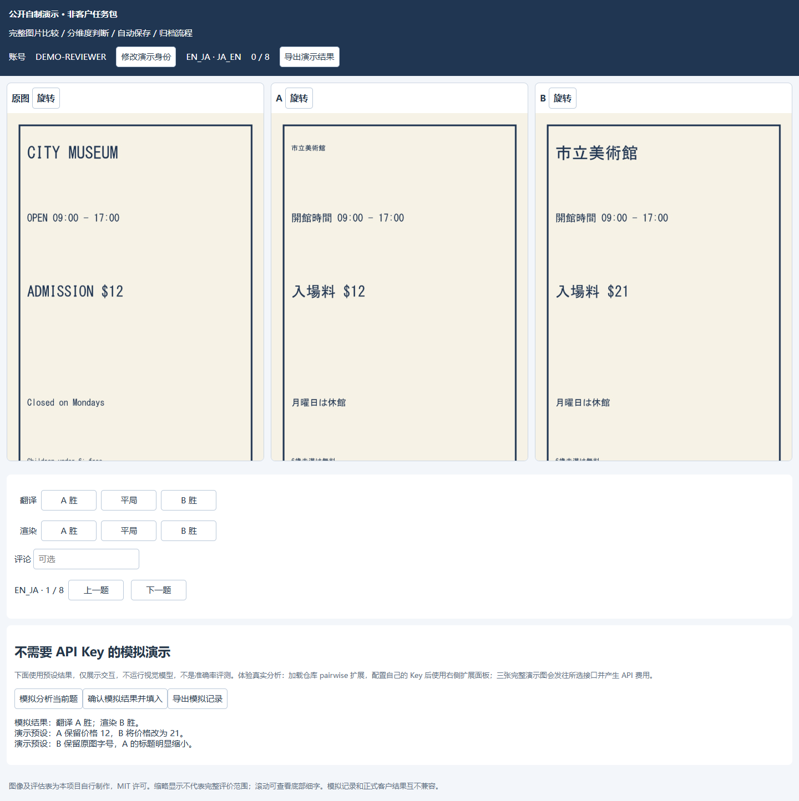

# Papago 翻译评价工具集

[](https://github.com/astkfu-cpu/papago-multimodel-evaluator/actions/workflows/ci.yml)


面向 Papago 相关图片翻译评价流程的 Edge / Chrome 扩展工具集，覆盖在线绝对打分与离线成对比较两种任务。

**核心维护者：[astkfu-cpu](https://github.com/astkfu-cpu)**。负责需求对接、任务规则适配、扩展实现、问题复现、持续优化、版本维护与使用支持。

## 实际应用与免费使用

维护者将工具免费提供给相关任务中的译员，已在两轮实际翻译评价任务中供多位译员反复使用，并根据使用反馈持续修复取图、切页、语言方向、接口响应、格式恢复及归档问题。该实践背景由维护者说明，工具没有植入用户追踪或收费系统。

**插件代码免费；模型 API 费用由使用者自行承担。** 使用者配置自己的 DeepSeek / 阿里云百炼账号与密钥。这里的“对接 Papago”指适配评价任务页面和离线工作流；本项目是独立维护的工具，与 NAVER / Papago 没有官方隶属或背书关系，不提供平台会员或 API 额度。

公开的实际使用统计、原图/A/B 示例和匿名归档见 [使用与证据](docs/USAGE_EVIDENCE.md)。统计只反映可核对的文件及记录，不将账号标签数量当作真实人数，不把模型评价当作人工金标准。

## 两个模块

| 模块 | 当前版本 | 任务与输入 | 输出 | 浏览器加载目录 |
| --- | --- | --- | --- | --- |
| [在线绝对打分](docs/ABSOLUTE.md) | 0.28.1 | Papago Pro 原图、译图及指定目标块 | 翻译/渲染分数、可选评论与归档 | 仓库根目录 |
| [离线成对评价](pairwise/README.md) | 1.1.0 | Userlog 完整原图及匿名 A/B | 两维独立 A 胜/平局/B 胜、理由与长期归档 | `pairwise/` |

两套扩展保留各自的清单、数据存储和规则。同仓库维护不表示两种评价标准可以互换。

## 安装与更新

1. 下载或克隆本仓库。打开 `edge://extensions/` 或 `chrome://extensions/`，启用开发者模式。
2. 选择“加载解压缩的扩展”，按上表选对应目录。离线模块还需在扩展详细信息中开启“允许访问文件 URL”。
3. 打开对应任务页面，配置自己的 API Key，先分析单张并核对理由，再按需使用连续模式。
4. 更新时停止任务，将源码覆盖在原扩展目录，点击“重新加载”，再刷新任务页面。不要卸载或换目录加载，以保留原扩展 ID、设置和 IndexedDB 记录。更新前先导出备份。

离线任务仅保留一个评价表页面；每日结束和提交节点仍通过原表导出正式 JSON。插件的 HTML 报告用于检查依据，不代替正式结果文件。

## 维护与可靠性

- 在线模块：原译图独立定位、高清资源读取、目标区域验证、接口与视觉故障区分、缓存隔离、切页及进度一致性核验。
- 离线模块：整图读取、逐题语言方向核对、两维独立判断、证据不足暂停、格式有界恢复、重复表保护、永久归档和离线报告。
- v1.0.2 修复缺失渲染理由、状态枚举不合法及返回包装格式问题；旧库名、版本及结构保持不变，覆盖升级保留旧记录。

详见 [更新日志](CHANGELOG.md)、[历史维护记录](docs/ABSOLUTE_HISTORY.md)、[测试说明](docs/TESTING.md) 和 [隐私说明](PRIVACY.md)。模型建议需要人工复核；自动化测试验证流程与数据保护，不代表模型准确率认证。

## 开发

要求 Node.js 20+。不需 API Key 的回归检查：

```sh
npm test
```

`npm run test:absolute` 检查在线模块，`npm run test:pairwise` 检查成对模块。浏览器测试及私有测试包配置见 [TESTING.md](docs/TESTING.md)。测试和实际评价记录分别保存。

## 公开样例与许可

代码采用 [MIT License](LICENSE)。`examples/` 中的实际任务示例由维护者选择并匿名化，仅用于说明功能和复核形式；它们不构成 Papago 官方许可、整套客户数据的再分发授权或可复用训练语料。详情见 [样例说明](examples/README.md)。


[English README](README.en.md) · [下载版本](dist/README.md) · [完整安装说明](docs/INSTALLATION.md) · [已知限制](docs/KNOWN_LIMITATIONS.md) · [问题反馈](https://github.com/astkfu-cpu/papago-multimodel-evaluator/issues/new/choose)


公开版成对模块使用通用评价模板，已移除客户内部规则；实际任务中的专用规则需另行获准配置。本机既有客户专用插件和归档未被修改。

## 独立演示与本次改进

直接下载并解压 [公开演示包](dist/papago-public-demo-1.0.0.zip)，打开 index.html 即可体验，不需要客户任务包或 API Key。所有图片和表格自行制作，模拟结果明确标注；真实模型分析需加载扩展并自付 API 费用。见 [演示说明](demo/README.md)。

成对 1.1.0 增加切题失效保护、模型自评置信度说明、[可恢复归档备份与分批导出](docs/ARCHIVE_BACKUP.md)。[GitHub Releases](https://github.com/astkfu-cpu/papago-multimodel-evaluator/releases) 提供版本标签、ZIP、校验值和升级说明。

尚未完成独立人工准确率评测或公开用户访谈，不把模拟演示或归档条数当作这些证据。后续工作见 [人工对照方案](docs/EVALUATION.md) 和 [真实反馈流程](docs/USER_FEEDBACK.md)。

演示界面（明确标注模拟结果）：


