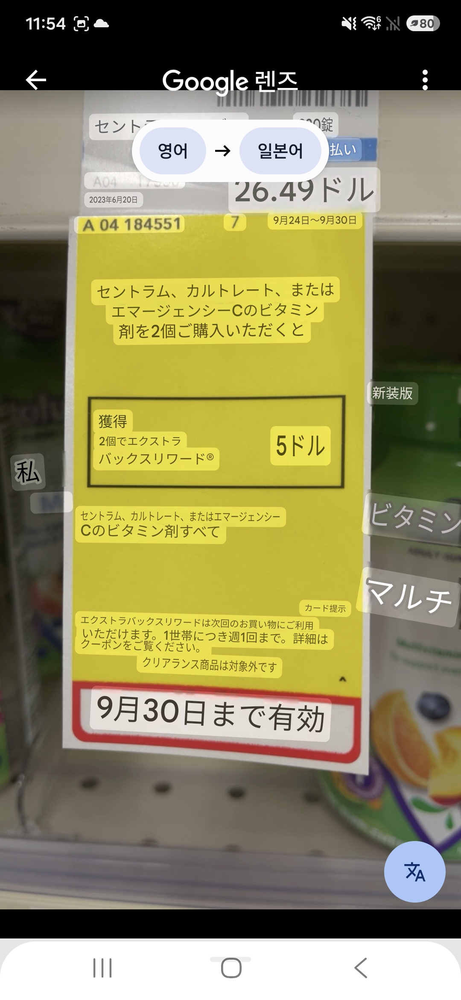

# 实际使用与公开证据

核心维护者 astkfu-cpu 将在线绝对打分和离线成对评价两套工具免费提供给实际任务使用者，已用于两轮任务，并提供给多位译员反复使用；模型 API 由使用者自行付费。这是维护者的实践说明，不表示 Papago 官方合作认证。

## 可核对的归档快照

统计日期：2026-10-21。来源为维护者提供的 **47 份成对评价 HTML 导出归档**，共 **37,497 条分析记录**。按“评价员标签 + 任务表 + 题目 ID”去重并保留最后更新时间后，为 **37,471 个评价项记录**，其中 **37,431 项标记为原表两项已保存**。包含 **47 个不同评价员账号、3 个语言组和 6 个语言方向**。

| 方向 | 去重评价项 | 标记已填入 |
| --- | ---: | ---: |
| EN_JA | 7,531 | 7,495 |
| EN_ZH-CN | 5,544 | 5,542 |
| JA_EN | 7,600 | 7,600 |
| JA_ZH-CN | 5,596 | 5,594 |
| ZH-CN_EN | 5,600 | 5,600 |
| ZH-CN_JA | 5,600 | 5,600 |

维护者已确认这些账号由实际参与任务的多位译员使用。上文按归档中的账号和评价项统计；已保存标记记录软件操作状态，不等同于客户验收。本快照只统计提供的成对归档，不包含第一轮在线打分任务的全部使用量。工具没有遥测，因此不发布虚构下载量、活跃人数或市场覆盖率。

机器可读统计见 [usage-summary.json](../examples/usage-summary.json)。公开仓库仅保留汇总，原始账号、任务表 ID、完整档案与原文件名映射不公开。

## 图片、评价与归档样例

选择了一组不含个人面孔、联系方式及客户沟通内容的商品标签图片，保留完整原图和两个待评译图。账号、题号、任务标识及路径均匿名化。

- [原图](../examples/pairwise/images/source.jpg) · [A 图](../examples/pairwise/images/A.jpg) · [B 图](../examples/pairwise/images/B.jpg)
- [实际模型结果摘录](../examples/pairwise/evaluation-result.json)
- [可离线打开的匿名归档](../examples/pairwise/archive-sample.html)

样例来自实际归档，不重新改写模型判断来美化效果；可能含模型错误，不能当作人工金标准或准确率验证。

## 持续维护证据

[GitHub 提交记录](https://github.com/astkfu-cpu/papago-multimodel-evaluator/commits/main/)展示已有公开版本及此次导入的本地维护版本。成对模块按实际存档的 1.0.0 → 1.0.1 → 1.0.2 源码逐次导入；在线模块同步到本地实际 0.28.1，并保留历史优化说明。提交时间记录本次发布日，不能倒推为所有功能的原始开发日期。

回归覆盖模型格式恢复、完整图读取、语言方向切换、页面保存、超过 100 条归档保留和覆盖升级。测试机制见 [TESTING.md](TESTING.md)，维护内容见 [CHANGELOG](../CHANGELOG.md)。这些证明工程流程有被检验，不证明模型所有评价都正确。

## 完整图片预览

| 原图 | A | B |
| --- | --- | --- |
|  |  |  |

原始记录中的名字和账号是译员用于工作的称呼，不是真实姓名。公开样例进一步使用匿名代号，不公开工作称呼与具体个人、账号和任务记录的对应关系。

复算工具：python scripts/summarize-archives.py <本机归档目录>。脚本只读输入，只输出汇总计数，不输出译员工作称呼、任务 ID 或本机路径；源文件不随仓库发布。
